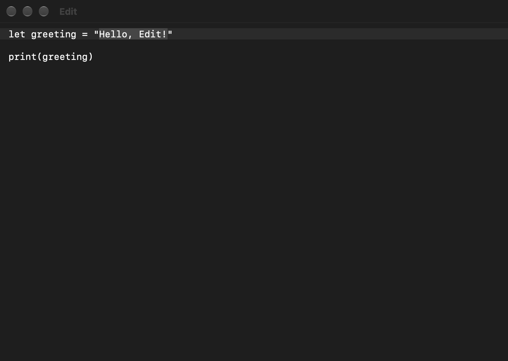

# Edit

A personal macOS text editor in Swift and AppKit. [Editor](docs/features/editor/spec.md) provides one native scratch buffer with plain-text editing, line commands, and scrolling. See the [project principles](docs/principles.md).

## Build and run

Requires macOS 27 and Apple Command Line Tools with the macOS 27 SDK and Swift 6.4. Build and run from Terminal.

| Command | Result |
| --- | --- |
| `./script/build` | Build and sign `.build/app/debug/Edit.app`. |
| `./script/build release` | Build and sign `.build/app/release/Edit.app`. |
| `./script/run` | Build and open the development app. |
| `./script/check` | Check the editor and render it in a separate, non-activating test app. |
| `./script/install` | Build Release and install Edit to `~/Applications`. Pass a directory to choose a different destination. |

The app build reuses SDK modules under `.local/swift-sdk` even when `.build` is recreated.
